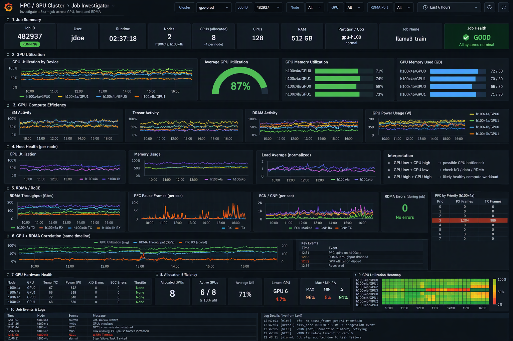

# Slurm GPU and RDMA Observability with Prometheus and Grafana

A practical design for monitoring NVIDIA H100/H200 GPU nodes, Slurm jobs, Linux hosts, and RoCEv2/RDMA fabrics from one intuitive Grafana workflow.

The primary operator question is:

> Is a slow job limited by the GPU, CPU, memory, Slurm allocation, RDMA NIC, or Ethernet fabric?



> **Note:** The dashboard image uses synthetic sample data. Names, values, events, and job identifiers are illustrative.

---

## Table of contents

- [1. Objectives](#1-objectives)
- [2. RDMA and RoCEv2 distilled](#2-rdma-and-rocev2-distilled)
- [3. Recommended observability stack](#3-recommended-observability-stack)
- [4. Deployment phases](#4-deployment-phases)
- [5. RDMA exporter design](#5-rdma-exporter-design)
- [6. RDMA metrics](#6-rdma-metrics)
- [7. Slurm job correlation design](#7-slurm-job-correlation-design)
- [8. GPU-to-job mapping](#8-gpu-to-job-mapping)
- [9. Prometheus joins and recording rules](#9-prometheus-joins-and-recording-rules)
- [10. Grafana Job Investigator dashboard](#10-grafana-job-investigator-dashboard)
- [11. Alerting design](#11-alerting-design)
- [12. Active RDMA probes](#12-active-rdma-probes)
- [13. Logs with Loki](#13-logs-with-loki)
- [14. Validation plan](#14-validation-plan)
- [15. Operational checklist](#15-operational-checklist)
- [16. Key design rules](#16-key-design-rules)
- [17. References](#17-references)

---

## 1. Objectives

Build one observability system that can:

- Show GPU fleet health and utilization.
- Identify allocated but idle GPUs.
- Correlate GPU behavior with Slurm jobs.
- Show CPU, memory, load, filesystem, and network behavior on allocated nodes.
- Detect RDMA transport errors and link problems.
- Distinguish normal congestion-control activity from sustained PFC pressure.
- Correlate PFC, ECN, CNP, throughput, GPU utilization, and job events on one timeline.
- Provide a Job ID driven troubleshooting workflow.
- Preserve Slurm accounting as the source of truth for historical job metadata.
- Avoid high-cardinality Prometheus designs.

Desired drill-down:

```text
Cluster
  -> Slurm job
    -> allocated nodes
      -> allocated GPU or MIG UUIDs
        -> RDMA interfaces and ports
          -> metrics, events, and logs
```

---

## 2. RDMA and RoCEv2 distilled

### 2.1 What RDMA provides

RDMA allows data movement between application memory and the NIC with less kernel and CPU involvement than a conventional TCP path.

```text
TCP:
Application -> kernel/TCP -> NIC -> network -> NIC -> kernel/TCP -> application

RDMA:
Application -> NIC ============================> NIC -> memory
```

Expected benefits:

- Lower latency
- Lower CPU overhead
- High throughput
- Better suitability for distributed GPU communication

### 2.2 RoCEv2

RoCEv2 carries RDMA over Ethernet, IP, and UDP. The standard destination UDP port is `4791`.

```text
Application or NCCL
        |
    RDMA verbs
        |
      RoCEv2
        |
 NVIDIA/Mellanox NIC
        |
 Routed Ethernet fabric
```

Typical GPU communication path:

```text
NCCL
  -> GPUDirect RDMA
    -> RoCEv2
      -> Ethernet fabric
```

### 2.3 Why packet handling matters

Traditional RoCE deployments are sensitive to packet loss. A practical fabric commonly combines:

- **ECN:** Switch marks congestion before queues overflow.
- **CNP:** Congestion Notification Packets relay congestion feedback.
- **DCQCN:** Sender reduces its rate in response to congestion.
- **PFC:** Priority Flow Control pauses one traffic priority as an emergency protection mechanism.

Operational model:

```text
ECN + CNP + DCQCN = normal congestion control
PFC               = emergency brake
```

A healthy fabric should not depend on continuous PFC.

### 2.4 DSCP and traffic classes

A routed RoCEv2 design can use DSCP to classify RDMA traffic into a switch traffic class and lossless priority.

```text
RoCE packet
  -> DSCP value
    -> switch traffic class
      -> queue
        -> ECN and selected PFC priority
```

Keep broadcast and multicast traffic out of the lossless RDMA class.

### 2.5 Important failure modes

#### PFC propagation

A congested or malfunctioning endpoint can generate pause frames that propagate upstream and affect unrelated systems.

#### PFC deadlock

Circular pause dependencies can prevent multiple ports from transmitting. Careful traffic-class design, topology controls, watchdogs, and validated switch behavior are required.

#### Slow receiver

A host or NIC that cannot drain receive traffic quickly enough can fill buffers and generate PFC even if the wider fabric is not overloaded.

#### RDMA livelock or retry behavior

A busy network or NIC does not guarantee useful application progress. Monitor transport errors, retries, latency, and application throughput together.

#### Bad endpoint or NIC

One malfunctioning NIC may issue excessive pause frames. Enable NIC and switch PFC watchdog functionality where supported.

---

## 3. Recommended observability stack

```text
GPU / compute nodes
+---------------------------------------------------+
| DCGM Exporter        GPU telemetry                |
| node_exporter        CPU, RAM, disk, Linux NICs   |
| RDMA collector       RoCE, PFC, ECN, CNP, errors |
| Slurm GPU mapper     Job -> GPU UUID mapping      |
+---------------------------+-----------------------+
                            |
                            v
                       Prometheus
                            |
             +--------------+--------------+
             |                             |
          Grafana                      Alertmanager
             |
             +-- Loki for logs and event correlation
```

### Components

| Component | Purpose |
|---|---|
| NVIDIA DCGM Exporter | GPU utilization, memory, power, temperature, clocks, ECC, XID, profiling, throttling |
| node_exporter | CPU, RAM, load, filesystems, Linux network, textfile metrics |
| Custom RDMA collector | RDMA links, counters, PFC, ECN, CNP, errors, discards |
| Slurm job mapper | Current job, node, GPU, and MIG allocation metadata |
| Prometheus | Time-series collection, joins, recording rules, alert evaluation |
| Grafana | Cluster, job, GPU, node, and fabric investigation dashboards |
| Alertmanager | Routing and grouping actionable alerts |
| Loki | `slurmd`, kernel, NVIDIA, mlx5, and NCCL logs |
| SlurmDBD | Long-term Slurm job accounting and metadata source of truth |

Do not begin with an oversized platform. A strong first version is:

```text
DCGM Exporter + node_exporter + RDMA textfile collector
+ Prometheus + Grafana + Alertmanager
```

Add Loki after numerical metrics and labels are stable.

---

## 4. Deployment phases

### Phase 1: GPU and Linux monitoring

Deploy:

- DCGM Exporter
- node_exporter
- Prometheus
- Grafana

Deliver:

- GPU fleet overview
- GPU health and utilization
- CPU and memory correlation

### Phase 2: Slurm job-to-node correlation

Deploy a central Slurm polling collector.

Deliver:

- Job selector
- Job summary
- Allocated node filtering
- Running and completing job visibility

### Phase 3: RDMA and RoCE collection

Deploy the RDMA textfile collector to one H100 node and one H200 node first.

Deliver:

- RDMA throughput
- Link state
- Errors and discards
- PFC by priority
- ECN and CNP

Validate metric mappings because mlx5 driver and firmware counter names vary.

### Phase 4: Job-to-GPU UUID correlation

Deploy:

- Slurm Prolog mapper
- Slurm Epilog cleanup or archival hook
- GPU index, PCI ID, UUID, and MIG UUID mapping

Deliver:

- Accurate per-job GPU panels
- Allocated but idle GPU detection
- GPU imbalance views

### Phase 5: Alerts and active probes

Add:

- Collector failure alerts
- Port-down alerts
- New RDMA error alerts
- Sustained PFC alerts
- Idle allocated GPU alerts
- RDMA latency canaries

### Phase 6: Logs

Add Loki and collect:

- `slurmd`
- kernel journal
- mlx5/NIC messages
- NVIDIA driver messages
- NCCL warnings and errors
- OOM events

---

## 5. RDMA exporter design

### 5.1 Initial implementation

Use the node_exporter textfile collector instead of building a long-running exporter first.

```text
/usr/local/sbin/rdma-prom-collector
       |
       +-- rdma link show
       +-- rdma statistic show
       +-- ethtool -S <netdev>
       +-- /sys/class/infiniband/*/ports/*/counters/*
       +-- /sys/class/infiniband/*/ports/*/hw_counters/*
       |
       v
/var/lib/node_exporter/textfile_collector/rdma.prom
```

Run every 15 seconds initially. Read counters only. Do not run bandwidth load tests on this schedule.

### 5.2 Atomic output

Never write the live `.prom` file in place.

```bash
#!/usr/bin/env bash
set -euo pipefail

out=/var/lib/node_exporter/textfile_collector/rdma.prom
tmp=$(mktemp "${out}.XXXXXX")
trap 'rm -f "$tmp"' EXIT

collect_metrics > "$tmp"
mv -f "$tmp" "$out"
trap - EXIT
```

### 5.3 systemd service

```ini
# /etc/systemd/system/rdma-prom-collector.service
[Unit]
Description=Collect RDMA and RoCE metrics for node_exporter
After=network-online.target
Wants=network-online.target

[Service]
Type=oneshot
ExecStart=/usr/local/sbin/rdma-prom-collector
User=root
Group=root
```

### 5.4 systemd timer

```ini
# /etc/systemd/system/rdma-prom-collector.timer
[Unit]
Description=Run RDMA Prometheus collector

[Timer]
OnBootSec=30s
OnUnitActiveSec=15s
AccuracySec=2s
Persistent=true

[Install]
WantedBy=timers.target
```

Enable:

```bash
systemctl daemon-reload
systemctl enable --now rdma-prom-collector.timer
systemctl status rdma-prom-collector.timer
```

### 5.5 Collector health metrics

Always expose measurement health:

```text
rdma_collector_success 1
rdma_collector_duration_seconds 0.083
rdma_collector_last_success_timestamp_seconds 1794001280
rdma_collector_parse_errors_total 0
```

Missing metrics must not look like zero errors.

### 5.6 Label design

Use stable, low-cardinality labels:

```text
cluster
node
instance
device
port
netdev
priority
rail
```

Example:

```text
roce_pfc_received_frames_total{
  cluster="gpu-prod",
  node="h100x4a",
  device="mlx5_0",
  port="1",
  netdev="ens8f0np0",
  priority="3",
  rail="compute"
} 18231
```

Do not add volatile labels such as `job_name`, `command`, or full job metadata to every infrastructure metric.

---

## 6. RDMA metrics

### 6.1 Port state

Prefer readable one-hot state metrics:

```text
rdma_port_state_info{device="mlx5_0",port="1",state="ACTIVE"} 1
rdma_port_physical_state_info{device="mlx5_0",port="1",state="LINK_UP"} 1
```

### 6.2 Traffic counters

Expose monotonically increasing counters:

```text
rdma_port_transmit_bytes_total
rdma_port_receive_bytes_total
rdma_port_transmit_packets_total
rdma_port_receive_packets_total
rdma_unicast_transmit_packets_total
rdma_unicast_receive_packets_total
```

Compute bandwidth in Prometheus:

```promql
rate(rdma_port_transmit_bytes_total[5m]) * 8
```

### 6.3 Transport and link errors

Map available adapter fields into stable metric names:

```text
rdma_receive_errors_total
rdma_transmit_discards_total
rdma_receive_discards_total
rdma_local_link_integrity_errors_total
rdma_symbol_errors_total
rdma_link_downed_total
rdma_excessive_buffer_overrun_errors_total
rdma_out_of_sequence_packets_total
rdma_duplicate_request_packets_total
rdma_retry_exceeded_errors_total
rdma_rnr_nak_retry_errors_total
```

Do not expose only raw driver counter names. Maintain a translation layer per tested driver or firmware family.

### 6.4 PFC by priority

```text
roce_pfc_transmitted_frames_total{priority="3"}
roce_pfc_received_frames_total{priority="3"}
roce_pfc_transmitted_duration_seconds_total{priority="3"}
roce_pfc_received_duration_seconds_total{priority="3"}
```

Keep priorities separate so misclassification is visible.

Useful PromQL:

```promql
rate(roce_pfc_received_frames_total[5m])
```

```promql
increase(roce_pfc_received_duration_seconds_total[10m])
```

Pause duration is often more meaningful than the frame count alone.

### 6.5 ECN and CNP

Normalize supported counters:

```text
roce_ecn_marked_packets_total
roce_cnp_transmitted_packets_total
roce_cnp_received_packets_total
roce_congestion_events_total
```

Interpretation:

| Observation | Likely meaning |
|---|---|
| ECN and CNP rising, no drops | Congestion control is reacting |
| PFC rising continuously | Queues are reaching emergency thresholds |
| Drops, retry errors, or timeouts rising | Transport is being affected |
| PFC rising across unrelated ports | Possible pause propagation or PFC storm |

---

## 7. Slurm job correlation design

The correlation layer must answer:

```text
Job ID
  -> owner and state
  -> start and end time
  -> allocated nodes
  -> allocated CPU, memory, and GPUs
  -> GPU or MIG UUIDs
  -> matching host and RDMA metrics
```

Use separate paths for current and historical jobs.

### 7.1 Current jobs

Poll the Slurm controller or a monitoring host every 15 to 30 seconds.

Example discovery command:

```bash
squeue --noheader \
  --states=RUNNING,COMPLETING \
  --Format=JobIDRaw,UserName,Partition,NodeList,StartTime,TimeUsed
```

Retrieve detailed allocation data when needed:

```bash
scontrol show job -o <jobid>
```

Useful fields:

```text
JobId
UserId
JobState
Partition
QOS
NodeList
BatchHost
StartTime
EndTime
TresPerNode
TresPerJob
AllocTRES
Gres
```

### 7.2 Current job metrics

```text
slurm_job_info{
  job_id="482937",
  user="jdoe",
  partition="gpu",
  qos="normal",
  state="RUNNING"
} 1
```

```text
slurm_job_node_info{
  job_id="482937",
  node="h100x4a"
} 1
```

```text
slurm_job_allocated_gpus{job_id="482937"} 4
slurm_job_allocated_cpus{job_id="482937"} 64
slurm_job_allocated_memory_bytes{job_id="482937"} 274877906944
```

### 7.3 Completed jobs

Use `sacct` and SlurmDBD for durable job history:

```bash
sacct -X \
  --starttime today \
  --state=COMPLETED,FAILED,CANCELLED,TIMEOUT,OUT_OF_MEMORY \
  --format=JobIDRaw,User,Partition,State,NodeList,AllocTRES,Start,End,Elapsed
```

Recommended ownership:

- SlurmDBD and its database remain the authoritative job history.
- Prometheus stores numeric job-time measurements and short-lived correlation metadata.
- Grafana queries Slurm accounting through a controlled data source or small metadata API when long-term detail is needed.

Prometheus is not a relational job database.

---

## 8. GPU-to-job mapping

### 8.1 Required translation

```text
Slurm allocation
  -> local GPU index
    -> PCI bus ID
      -> physical GPU UUID
        -> DCGM metric
```

For MIG:

```text
Job
  -> node
    -> parent GPU UUID
      -> GPU instance
        -> compute instance
          -> MIG UUID
```

### 8.2 Prolog mapper

Use a Slurm Prolog, or later a SPANK plugin, to collect:

```text
SLURM_JOB_ID
SLURM_JOB_USER
SLURM_JOB_GPUS
SLURM_STEP_GPUS
CUDA_VISIBLE_DEVICES
```

Map device indexes to stable identifiers:

```bash
nvidia-smi \
  --query-gpu=index,uuid,pci.bus_id \
  --format=csv,noheader,nounits
```

Write a node-local map:

```text
/run/slurm-gpu-map/482937.map
```

Example record:

```text
job_id=482937
node=h100x4a
gpu_index=0
gpu_uuid=GPU-3b5...
pci_bus_id=00000000:81:00.0
```

Expose:

```text
slurm_job_gpu_info{
  job_id="482937",
  node="h100x4a",
  gpu_uuid="GPU-3b5..."
} 1
```

### 8.3 Epilog behavior

At job completion:

1. Send or preserve the final mapping for historical analysis if required.
2. Remove the active textfile mapping.
3. Record cleanup success or failure.

Do not leave stale active-job mappings.

### 8.4 MIG considerations

If MIG is possible, design for `mig_uuid` now. Do not depend only on parent GPU index or UUID.

Example:

```text
slurm_job_mig_info{
  job_id="482937",
  node="h100x4a",
  gpu_uuid="GPU-...",
  mig_uuid="MIG-GPU-.../GI.../CI..."
} 1
```

---

## 9. Prometheus joins and recording rules

### 9.1 RDMA traffic for a selected job

Use the same `node` label in both metric families.

```promql
rate(rdma_port_transmit_bytes_total[5m])
and on(node)
slurm_job_node_info{job_id="$job_id"}
```

### 9.2 GPU utilization for a selected job

```promql
avg_over_time(DCGM_FI_DEV_GPU_UTIL[5m])
and on(node, gpu_uuid)
slurm_job_gpu_info{job_id="$job_id"}
```

Adjust label names to match the exact DCGM Exporter version and relabeling configuration.

### 9.3 Allocated but idle GPUs

```promql
(
  avg_over_time(DCGM_FI_DEV_GPU_UTIL[15m]) < 10
)
and on(node, gpu_uuid)
slurm_job_gpu_info
```

Require persistence and exclude startup, checkpoint, interactive, and maintenance periods.

### 9.4 Recording rules

```yaml
groups:
  - name: rdma-recording
    interval: 30s
    rules:
      - record: node:rdma_tx_bits_per_second:rate5m
        expr: rate(rdma_port_transmit_bytes_total[5m]) * 8

      - record: node:rdma_rx_bits_per_second:rate5m
        expr: rate(rdma_port_receive_bytes_total[5m]) * 8

      - record: node:roce_pfc_rx_frames:rate5m
        expr: rate(roce_pfc_received_frames_total[5m])

      - record: node:roce_cnp_rx:rate5m
        expr: rate(roce_cnp_received_packets_total[5m])

      - record: node:rdma_errors:increase5m
        expr: |
          increase(rdma_receive_errors_total[5m])
          + increase(rdma_transmit_discards_total[5m])
```

Recording rules simplify Grafana panels and reduce repeated expensive joins.

---

## 10. Grafana Job Investigator dashboard

### 10.1 Dashboard variables

| Variable | Example | Purpose |
|---|---|---|
| `$cluster` | `gpu-prod` | Select cluster |
| `$job_id` | `482937` | Primary investigation key |
| `$node` | `All` | Allocated-node filter |
| `$gpu_uuid` | `All` | Physical GPU filter |
| `$mig_uuid` | `All` | Optional MIG filter |
| `$rdma_device` | `All` | RDMA adapter filter |
| `$priority` | `3` | RoCE PFC priority |

Variable flow:

```text
cluster
  -> running or historical job
    -> allocated nodes
      -> allocated GPUs or MIG devices
        -> RDMA interfaces
```

### 10.2 Dashboard initial view

Keep these rows expanded:

1. Job Summary
2. GPU Utilization
3. RDMA Health
4. GPU and RDMA Correlation

Keep deeper diagnostic rows collapsed by default.

### 10.3 Row 1: Job Summary

Use Stat panels.

| Panel | Example |
|---|---|
| Job | `482937`, `RUNNING` |
| User | `jdoe` |
| Runtime | `02:37:18` |
| Nodes | `2` |
| GPUs | `8` |
| CPUs | `128` |
| RAM | `512 GB` |
| Partition / QoS | `gpu-h100 / normal` |
| Job name | `llama3-train` |
| Job health | `GOOD` |

Do not present an unexplained numeric health score. Use explicit states:

```text
GOOD
GPU IDLE
GPU IMBALANCE
CPU BOTTLENECK
GPU THROTTLED
RDMA CONGESTION
RDMA ERROR
GPU ERROR
```

### 10.4 Row 2: GPU Utilization

#### GPU utilization by device

- Visualization: Time series
- One line per allocated GPU
- Unit: percent
- Threshold hints: below 10%, 10% to 50%, above 50%

These are investigation hints, not universal health limits.

#### Average GPU utilization

- Visualization: Gauge or Stat
- Use the selected job and selected time range

#### GPU memory utilization

- Visualization: Bar gauge
- One row per GPU

#### GPU memory used

- Visualization: Bar gauge
- Unit: GiB
- Show used versus total memory

### 10.5 Row 3: GPU Compute Efficiency

Use time-series panels:

- SM activity
- Tensor activity, when the field is supported and collected
- DRAM activity
- GPU power
- Optional PCIe and NVLink throughput

Interpretation examples:

| Pattern | Interpretation |
|---|---|
| High SM, moderate DRAM, high power | Compute-heavy workload |
| Moderate SM, high DRAM | Memory-bandwidth-heavy workload |
| Low SM, low DRAM, low power | GPU may be starved or waiting |
| High utilization with throttling | Investigate power, thermal, or clock limits |

### 10.6 Row 4: Host Health

Panels:

- CPU utilization by allocated node
- Normalized load average
- Available and used memory
- Swap activity
- Filesystem throughput or data volume I/O when relevant

Interpretation panel:

```text
GPU low + CPU high -> possible CPU bottleneck
GPU low + CPU low  -> check storage, data pipeline, synchronization, or RDMA
GPU high + CPU high -> likely active compute workload
```

### 10.7 Row 5: RDMA and RoCE

#### RDMA throughput

- Visualization: Time series
- Unit: Gb/s
- Show TX and RX per node or port

#### PFC

- Visualization: Time series
- Show TX and RX frames per second
- Filter or split by PFC priority
- Add pause duration when available

#### ECN and CNP

- Visualization: Time series
- Show ECN marks, CNP RX, and CNP TX

#### RDMA errors during job

- Visualization: Stat
- Calculate increases within the selected job range, not lifetime totals

#### PFC by priority

- Visualization: Table
- Columns: node, interface, priority, RX frames, TX frames, pause duration
- Highlight activity on unexpected priorities

### 10.8 Row 6: GPU and RDMA Correlation

Put these signals on the same timeline:

- Average GPU utilization
- RDMA throughput
- PFC
- ECN and CNP
- RDMA errors
- Optional CPU utilization

A useful pattern is:

```text
PFC rises
  -> CNP rises
    -> RDMA throughput drops
      -> GPU utilization drops
```

Add a Key Events table showing timestamped state changes.

### 10.9 Row 7: GPU Hardware Health

Use a table:

| Node | GPU | Temperature | Power | XID | ECC | Throttle |
|---|---|---:|---:|---:|---:|---|
| h100x4a | GPU0 | 67 C | 612 W | 0 | 0 | None |

Highlight any new XID event during the job in red. Show current or recent throttle reason as text.

### 10.10 Row 8: Allocation Efficiency

Stat panels:

- Allocated GPUs
- Active GPUs
- Average utilization
- Lowest-utilized GPU
- Maximum utilization
- Minimum utilization
- Max-minus-min imbalance

Example:

```text
Allocated: 8
Active:    6 / 8
Average:   71%
Lowest:    GPU 6 at 4.7%
Max/Min:   96% / 5%
Delta:     91 percentage points
```

### 10.11 Row 9: Node by GPU Heatmap

Rows:

```text
h100x4a / GPU0
h100x4a / GPU1
h100x4a / GPU2
h100x4a / GPU3
h100x4b / GPU0
h100x4b / GPU1
h100x4b / GPU2
h100x4b / GPU3
```

Columns represent time. Color represents GPU utilization.

This quickly exposes a single stalled GPU or rank.

### 10.12 Row 10: Job Events and Logs

After Loki is available, show one ordered stream:

```text
12:31:07 slurmd  Job 482937 started
12:31:16 nvidia  GPUs initialized
12:31:44 NCCL    Communicator initialized
12:47:03 mlx5    PFC pause frames increased
12:47:05 NCCL    Timeout warning
12:48:11 slurmd  Job step failed
```

Filter logs using:

```text
job_id
node
gpu_uuid
mig_uuid
```

### 10.13 Recommended visualization types

Use mostly:

- Stat
- Time series
- State timeline
- Heatmap
- Table
- Bar gauge

Avoid excessive pie charts, donut charts, and decorative gauges. The dashboard is a fault-isolation tool.

---

## 11. Alerting design

Use symptom-based and correlated alerts rather than alerting on every raw counter.

### 11.1 Collector failure

```promql
rdma_collector_success == 0
```

Initial hold time: 2 minutes.

### 11.2 Stale collector

```promql
time() - rdma_collector_last_success_timestamp_seconds > 120
```

### 11.3 RDMA port inactive

```promql
rdma_port_state_info{state="ACTIVE"} != 1
```

Alert immediately for active production GPU nodes, but suppress expected maintenance.

### 11.4 New transport errors

```promql
increase(rdma_receive_errors_total[5m]) > 0
```

Also evaluate retry, RNR, discard, link-down, and integrity counters that are meaningful for the installed adapter.

### 11.5 PFC storm

Initial example only:

```promql
rate(roce_pfc_received_frames_total[5m]) > 100
```

Combine with pause duration when possible:

```promql
increase(roce_pfc_received_duration_seconds_total[5m]) > 1
```

Do not treat these example values as universal thresholds. Baseline representative NCCL workloads and set warning/critical thresholds from observed normal behavior, such as sustained levels beyond the normal 95th or 99th percentile.

### 11.6 Allocated GPU idle

Concept:

```promql
avg_over_time(DCGM_FI_DEV_GPU_UTIL[30m]) < 10
```

Join against active GPU allocation metadata.

Exclude:

- Job age below 10 minutes
- Interactive or development partitions
- Known test jobs
- Checkpoint or data-staging phases
- Maintenance reservations

### 11.7 GPU imbalance

Alert when one GPU remains far below peers in the same multi-GPU job. Example starting rule:

```text
max GPU utilization - min GPU utilization > 50 percentage points
for 15 minutes
```

Tune by workload class.

### 11.8 Correlated congestion alert

High-value condition:

```text
running multi-node GPU job
AND sustained PFC or CNP elevation
AND RDMA throughput reduction
AND GPU utilization reduction
```

This is more actionable than PFC alone.

### 11.9 GPU hardware alerts

Alert on:

- New XID errors
- Uncorrectable ECC errors
- Repeated correctable ECC growth
- Thermal throttling
- Persistent power throttling when unexpected
- GPU disappearance or DCGM scrape failure

---

## 12. Active RDMA probes

Passive counters do not prove end-to-end RDMA functionality.

Add lightweight active latency probes between selected node pairs or fabric zones:

```text
h100x4a <-> h100x4b
h100x4a <-> h200x8a
h100x4b <-> h200x8b
```

Record:

```text
rdma_probe_success
rdma_probe_rtt_seconds
rdma_probe_failures_total
```

Guidelines:

- Use small probes for regular health testing.
- Keep test traffic lightweight.
- Run heavier `ib_write_bw`, `ib_read_bw`, `ib_write_lat`, or NCCL tests only during scheduled validation windows.
- Do not run continuous full-bandwidth tests from every node.

A long-term graph should reveal baseline latency and step changes.

---

## 13. Logs with Loki

Prometheus explains **what changed**. Logs often explain **why**.

Collect:

```text
slurmd logs
kernel and journald messages
NVIDIA XID and driver messages
mlx5 and RDMA link messages
NCCL warnings, timeouts, and transport errors
OOM events
```

Desired timeline:

```text
14:32 GPU utilization drops
14:32 PFC RX spikes
14:32 RDMA throughput drops
14:32 NCCL timeout appears
14:33 Slurm job step fails
```

Use consistent labels, but avoid placing full log messages or unbounded values in labels.

---

## 14. Validation plan

### 14.1 Node validation

On each representative NIC/driver family:

```bash
rdma link
rdma statistic show
ibv_devices
ibv_devinfo
ip -d link show
ethtool -S <interface>
```

Confirm:

- RDMA device-to-netdev mapping
- Port number
- Link state
- RoCE mode
- Counter availability
- PFC priority
- ECN and CNP counters
- Counter units and wrap behavior

### 14.2 Prometheus validation

Check:

```text
node_exporter target is UP
RDMA collector success is 1
RDMA metric timestamps are current
counter values increase under traffic
no duplicate series
labels are consistent across node, DCGM, and Slurm metrics
```

### 14.3 Slurm validation

Test:

1. Single-node, one-GPU job
2. Single-node, all-GPU job
3. Multi-node NCCL job
4. Failed job
5. Cancelled job
6. OOM job
7. GPU-exclusive and shared modes
8. MIG allocation, if enabled

Verify that Prolog and Epilog mappings are created and removed correctly.

### 14.4 Network validation

Progress gradually:

```text
Two nodes
  -> small GPU test cluster
    -> one ToR
      -> multiple ToRs and leaf
        -> wider production fabric
```

At each stage validate:

- MTU consistency
- DSCP-to-traffic-class mapping
- PFC limited to the selected RDMA class
- ECN thresholds
- PFC watchdog behavior
- Buffer/headroom behavior
- No broadcast or multicast in the lossless class
- Active RDMA latency and failures
- NCCL throughput and stability

---

## 15. Operational checklist

### NIC

```text
[ ] RoCEv2 enabled
[ ] Correct driver and firmware combination
[ ] Consistent MTU
[ ] DSCP configured
[ ] Correct traffic class and PFC priority
[ ] ECN and congestion control configured
[ ] PFC watchdog enabled where supported
[ ] Required PFC, ECN, CNP, and error counters available
```

### Switch

```text
[ ] Same MTU end to end
[ ] DSCP-to-traffic-class mapping validated
[ ] PFC enabled only for the selected RDMA class
[ ] ECN thresholds configured and validated
[ ] Buffer and headroom configuration reviewed
[ ] PFC watchdog configured
[ ] Dynamic or shared buffer behavior understood
[ ] Broadcast and multicast excluded from lossless class
[ ] Switch telemetry exported to Prometheus or correlated in Grafana
```

### Linux and Slurm

```text
[ ] DCGM Exporter running
[ ] node_exporter running
[ ] RDMA collector timer running
[ ] Slurm current-job collector running
[ ] Prolog creates GPU UUID mapping
[ ] Epilog archives or removes mapping
[ ] SlurmDBD accounting healthy
[ ] Node names are consistent across all metric sources
```

### Grafana

```text
[ ] Job ID drives node and GPU variables
[ ] Metrics are filtered to the job time range
[ ] Lifetime counters are converted to increases or rates
[ ] PFC is separated by priority
[ ] GPU and RDMA signals share a timeline
[ ] Events and logs use the same node and job filters
[ ] Dashboard rows are collapsible
```

---

## 16. Key design rules

1. **Use the Slurm Job ID as the operator entry point.**
2. **Keep GPU and RDMA metrics stable by node and device.**
3. **Keep volatile job metadata in separate mapping metrics.**
4. **Join by consistent `node`, `gpu_uuid`, and optional `mig_uuid` labels.**
5. **Use SlurmDBD for permanent job history.**
6. **Use Prometheus for time-series metrics, not as a relational job database.**
7. **Treat ECN/CNP as normal congestion-control signals and PFC as the emergency brake.**
8. **Monitor PFC duration, priority, scope, and persistence, not only frame counts.**
9. **Baseline before setting PFC or utilization thresholds.**
10. **Investigate new errors during the selected job range, not only device lifetime totals.**
11. **Correlate GPU, CPU, RDMA, network, and logs on the same timeline.**
12. **Deploy gradually from representative nodes to ToR, leaf, and wider fabric.**
13. **Enable watchdogs to limit damage from a bad endpoint or stuck PFC condition.**
14. **Design for MIG UUIDs now if MIG may be introduced later.**
15. **Make dashboards explicit and actionable, not decorative.**

The target operator experience is:

```text
Enter Job ID
  -> confirm allocation
  -> inspect GPU balance
  -> inspect host pressure
  -> inspect RDMA throughput and congestion
  -> inspect hardware errors
  -> inspect aligned events and logs
  -> identify the most likely bottleneck
```

---

## 17. References

- Microsoft Research, **RDMA over Commodity Ethernet at Scale**, SIGCOMM 2016: [local copy](./rdma_sigcomm2016.pdf)
- NVIDIA, [GPU Telemetry documentation](https://docs.nvidia.com/datacenter/cloud-native/gpu-telemetry/latest/)
- NVIDIA, [Setting up Prometheus for GPU telemetry](https://docs.nvidia.com/datacenter/cloud-native/gpu-telemetry/latest/kube-prometheus.html)
- Grafana Labs, [NVIDIA DCGM integration](https://grafana.com/grafana/plugins/integrationplumbers-nvidiadcgm-app/)
- Prometheus, [Configuration documentation](https://prometheus.io/docs/prometheus/latest/configuration/configuration/)
- Prometheus, [Recording rules](https://prometheus.io/docs/prometheus/latest/configuration/recording_rules/)
- Slurm, [squeue documentation](https://slurm.schedmd.com/squeue.html)
- Slurm, [scontrol documentation](https://slurm.schedmd.com/scontrol.html)
- Slurm, [sacct documentation](https://slurm.schedmd.com/sacct.html)
- NVIDIA, [DCGM Exporter repository](https://github.com/NVIDIA/dcgm-exporter)
- Prometheus, [node_exporter repository](https://github.com/prometheus/node_exporter)

---

## License and adaptation

This design is intended as an operational starting point. Metric names, NIC counters, DCGM fields, Slurm fields, thresholds, and switch behavior must be validated against the exact driver, firmware, Slurm, Grafana, and fabric versions in the deployment.
